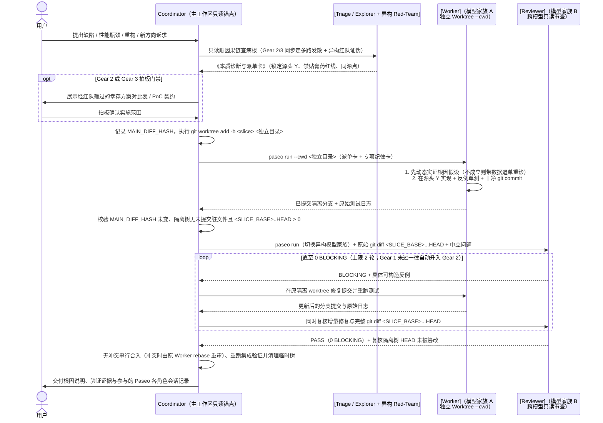

# Paseo Engineering（异构多 Agent 根源诊断与隔离工程脚手架）

<div align="center">
  <p><strong>面向 Paseo、Antigravity、Codex 与 `.agents` 生态的通用根源分流、独立 Worktree 隔离开发与跨模型异构审查工作流。</strong></p>
  <p>
    <a href="README.md">English</a> · <strong>简体中文</strong>
  </p>
  <p>
    
    
    
    
  </p>
</div>

---

## 为什么需要这套工作流

单 Agent 编码以及同质化多 Agent 协作，在真实工程任务里最容易栽在三个结构性问题上：

1. **既当裁判又当运动员（“小任务”沦为表象贴膏药）**：如果让有写权限的同一个 Agent 自己判定“这是不是小改动”，它天然倾向于在报错行随手加一句 `if (x == null) return;` 交差，掩盖上游被破坏的不变量。
2. **同模型思维盲区与自写自审放水**：同一个模型家族自己提方案、自己写代码、自己做检查时，确认偏误会让它下意识放过隐藏的失效入口、锁序反转或过低的端到端收益上限。
3. **流程轻重失调**：根因唯一的点状修复套五阶段重门禁纯属空转；而路线未定的 `0 → 1` 新方向如果不跑轻量隔离 PoC 探针就直接上生产级门禁，一旦假设不成立则全盘白干。

**Paseo Engineering** 通过把 **“谁只读定性分流、谁多维探路、谁跨模型唱反调、谁在独立 Git Worktree 动刀提交、谁跨模型审原始 Diff、谁无冲突串行合入”** 彻底拆开，按问题本质自动挂入三档执行流，在保证根源质量的同时确保主工作区与全局包缓存零意外污染。

---

## 六大 Agent 角色职责与权限红线

除纯机械改字外，**主会话严禁既做调度裁判又直接下场写业务代码**。所有工程任务由以下六类角色协同完成：

| 角色代号 | 核心功能（干什么） | 工作区与读写红线（严禁干什么） | 输入原件 → 交付产物 | 跨模型家族制衡规则 |
| :--- | :--- | :--- | :--- | :--- |
| **`Coordinator`<br>总诊协调官** *(主会话)* | 识别意图、对主工作区做状态快照（`MAIN_DIFF_HASH`）、维护磁盘 `status.md` 账本、切分独立 Git worktree、派发与回收 Paseo 子会话、执行**无冲突**串行合入并重跑集成验证 | 主工作区只读锚定与无冲突合入；**严禁直接编写业务代码或亲手解合并冲突** | 用户诉求 → 角色派单指令、合入代码与最终验证报告 | 当前主会话模型 |
| **`[Triage]`<br>本质分流官** | 顺因果链从**症状点 `X`** 逆向追到**不变量首次破坏源头 `Y`**，全仓普查同源漏点，拆分复合问题，定档并指定专项卡 | **只读约束**（提示词+`MAIN_DIFF_HASH` 双重核验；禁改代码、禁在主目录跑产生副产物的构建） | 报错栈/日志/现象 → **《本质诊断与派单卡》**（含禁贴膏药红线） | 线索聚焦时由协调官只读兼任；跨度大时派独立长上下文/高推理子会话 |
| **`[Explorer]`<br>正交探路与调研员** | **Gear 2**：沿*局部渐进 / 结构重构 / 边界外移*三正交范式发散方案；<br>**Gear 3**：按*外部路线横评 × 内部真实硬样本*双线摸底 | **只读约束** | 已锚定的事实与不变量 → 候选方案集或技术路线横评表 | 并行发散最多使用 `N-1` 个模型家族（保留 ≥1 个异构家族供红队使用） |
| **`[Red-Team]`<br>异构红队证伪官** | 对照最新源码/字节码专门**挑刺证伪** `[Explorer]` 的方案（查主干重复、搜隐藏绕过入口、算端到端真上限），或对真实硬样本做**事前验尸** | **只读约束** | 候选方案 + 原始代码路径 → 可构造反例清单与淘汰裁决 | **强制与被审候选方案的 `[Explorer]` 作者不同模型家族** |
| **`[Worker]`<br>隔离执行员** | `1 Worker = 1 独立分支 = 1 独立 Worktree`；首步先动态实证根因假设（**推翻假设有权带数据退单重诊**），再完成源头修复 + 反例单测（或轻量 PoC 探针）并在隔离分支完成提交 | **仅限在 `--cwd` 绑定的独立 worktree 与隔离本地包缓存内读写**；禁碰主工作区、禁写全局缓存、禁 `git push` | 派单卡 + 独立 worktree → 干净的隔离分支提交（commits）、反例测试与原始日志 | 按任务复杂度选强编码 / 强推理模型 |
| **`[Reviewer]`<br>双视角异构审查与审计官** | 负责方案双预审、对隔离分支已提交 `git diff <SLICE_BASE>...HEAD` 做双后审（*视角 A 审语义/并发/退化守恒 · 视角 B 审反例覆盖/产物纯净度*）及探针/基准原始数据强制终审 | **只读约束**（提示词+主工作区/隔离树双快照核验；直接读取隔离分支原件、diff 与日志，禁听摘要） | 已提交分支 diff + 原始测试/基准日志 → `PASS` 或附反例证据的 `BLOCKING` | **强制与对应 `[Worker]` 不同模型家族** *(同家族 Opus 审 Sonnet 不算异构)* |

### 各角色在三档执行流中的出场配合表

| 档位 | 命中的问题本质 | 出场的 Paseo 角色与协同拓扑 | 人工停顿次数 |
| :--- | :--- | :--- | :---: |
| **Gear 1 · 源头快修** | 根因唯一明确、无多路线架构取舍 | `Coordinator` + `[Triage]` → `1 个隔离 [Worker]` → `1 个异构 [Reviewer]` → 无冲突串行合入 | **`0` 次** *(2 轮未清零或现跨层耦合自动熔断升入 Gear 2)* |
| **Gear 2 · 深度攻坚 (`1 → N`)** | 隐蔽性能瓶颈、系统性漏误报、跨模块或跨上游二方库权衡 | `Coordinator` + `[Triage]` → `2–3 个 [Explorer]` → `异构 [Red-Team]` → **[拍板]** → `2 个预审 [Reviewer]` → `1–2 个隔离 [Worker]` → `2 个异构后审 [Reviewer]`（+ 数据审计）→ 无冲突串行合入 | **`1` 次** *(在幸存方案对比表处拍板)* |
| **Gear 3 · 探索立项 (`0 → 1`)** | 现有体系空白、技术路线未定、需验证核心假设 | `Coordinator` + `[Triage]` → `[Explorer-Outward]` + `[Explorer-Inward]` → `异构 [Red-Team]` → **[停顿 1]** → `隔离 [Worker-Spike]` + `异构 [Reviewer-Audit]` → **[停顿 2：Go / Pivot / Kill]** *(Go 后丢弃草稿探针并转入 Gear 2 后半段)* | **`2` 次** *(定 PoC 契约 & Go/Kill 裁决)* |

---

## Paseo 独立 Worktree 代码管理与异构审查五步闭环

所有涉及代码改动的档位均遵循统一的五步隔离协议——即使候选方案最终被证伪撤回，主工作区和全局依赖缓存（如 `~/.m2`、虚拟环境）也始终保持原状零污染：



---

## 渐进式模块与专项硬约束卡

默认仅加载精简的 `SKILL.md` 总控入口，复杂模式与领域硬约束卡按需挂载：

| 层级 | 文件入口 | 强制执行的核心纪律 |
| :--- | :--- | :--- |
| **总控路由与隔离底座** | [`SKILL.md`](skills/zh-CN/paseo-engineering/SKILL.md) | 六角色权责红线、跨模型家族强制配对、Stage 00 只读分流、Gear 1 双人快修及五步隔离代码管理。 |
| **Gear 2 深度攻坚 (`1 → N`)** | [`mode-deep-solve.md`](skills/zh-CN/paseo-engineering/references/mode-deep-solve.md) | `[Explorer]` 三范式发散、`[Red-Team]` 代码证伪、双视角预审/后审闭环与未达标干净丢弃。 |
| **Gear 3 探索立项 (`0 → 1`)** | [`mode-explore-spike.md`](skills/zh-CN/paseo-engineering/references/mode-explore-spike.md) | 内外双线 `[Explorer]`、事前验尸、Spike 契约、强制异构探针数据审计及 Go → Gear 2 衔接。 |
| **性能专项硬约束卡** | [`lens-performance.md`](skills/zh-CN/paseo-engineering/references/lens-performance.md) | 端到端真分母与 Amdahl `<5%` 淘汰线、缓存失效完备性证明、运行包条目级 SHA 比对、绑核/互斥锁计时、输出与降级多重集零漂移。 |
| **缺陷与精度专项卡** | [`lens-bug-precision.md`](skills/zh-CN/paseo-engineering/references/lens-bug-precision.md) | 红绿最小复现先行、源头不变量修复（严禁下游判空掩盖）、全仓同源普查、正反双向回归（防修漏报引误报）。 |
| **重构与架构专项卡** | [`lens-refactor-arch.md`](skills/zh-CN/paseo-engineering/references/lens-refactor-arch.md) | 反射/SPI/外部契约全盘点、单轨收敛清理旧轨（防永久双轨泥潭）、可观察行为快照等价。 |

---

## 快速安装

依赖 Python 3.8+（无第三方依赖，支持 Linux / macOS / Windows）。

```bash
git clone https://github.com/Scrates1/paseo-engineering.git
cd paseo-engineering

# 全局安装简体中文版（接入 Paseo + Antigravity + Codex + ~/.agents）
python3 scripts/install.py --lang zh-CN

# 或全局安装英文版
python3 scripts/install.py --lang en
```

安装脚本执行的无损合并操作：
- 将技能安装至 `~/.paseo/skills/paseo-engineering/`；
- 自动软链（Windows 或 `--copy` 时复制）至 `~/.gemini/config/skills/`、`~/.codex/skills/`、`~/.agents/skills/`；
- 原子备份 `~/.paseo/config.json`（保留原权限如 `0600`），**按 `<!-- paseo-engineering:start/end -->` 标记块与 `paseo_eng_*` 角色 ID 增量合并更新**（完整保留已有的其他共享提示块与用户自定义 Profile），并调用 `paseo reload` 无中断热重载。*(若目标主机可用模型列表不同，可通过 `paseo provider models <provider>` 核对并按需调整 `profiles/` 中的模型 ID。)*

仅预览操作不落盘：

```bash
python3 scripts/install.py --lang zh-CN --dry-run
```

---

## 日常控场口令

新建 Paseo 会话会自动分流执行；需要手动指定节奏时，在指令末尾顺手带半句话即可：

| 你的目的 | 附加口令示例 |
| :--- | :--- |
| 只探源和红队证伪，先别动代码 | *“只做前半段探源和红队反证，先别写代码”* |
| 夜间挂机全自动跑到底 | *“选通过红队反证的最优根源方案，直接全自动推进到底”* |
| 看似小事但怀疑水深，强制深度会诊 | *“别打补丁，按 Gear 2 多 Agent 探源和异构审查来做”* |
| 重启或配额切换后断点续跑 | *“读一下运行账本（`status.md`）继续刚才的任务”* |
| 终端独立运行 `agy` / `codex` CLI | 提及 `paseo-engineering`（Codex 下可用 `$paseo-engineering`） |

---

## 仓库校验测试

```bash
python3 -m unittest discover -s tests -v
```

---

## 许可证

基于 [MIT License](LICENSE) 开源发布。
